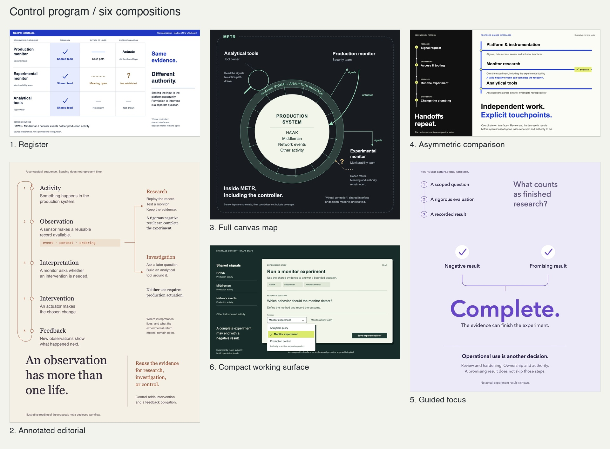

# lena's skills

Reusable agent skills for creating clear artifacts, explaining engineering work, and publishing HTML. The HTML family includes its instructions, examples, editable sources, and renderer; it needs no prior chat, private file path, or local project.

## Start with HTML Artifacts

Install the creation and optional publishing skills into your agent's global skill directory:

```sh
npx skills add love-lena/skills --skill html-artifacts upload-artifact -g
```

The installer lets you choose an agent. Add `-a codex` or `-a claude-code` to select one directly; omit `-g` for a project-local install. Node.js/npm are needed for this installer, not for viewing generated HTML. Open a new agent session if newly installed skills are not discovered immediately.

Try these prompts in a skill-aware agent (Codex supports the `$skill-name` spelling):

```text
Use $html-artifacts to turn these notes into a self-contained HTML report.
```

```text
Use $html-artifacts in Fancy mode to prototype a fast design-feedback form.
Choose an approach that suits frequent keyboard entry. Make the controls work.
```

```text
Use $html-artifacts to explain this system through visuals and sparse labels.
```

```text
Use $upload-artifact to upload this HTML file to artifacts.lena.dog privately.
```

**Plain is the default.** Fancy adds six approaches to composition and interaction. Visual Explainer is a teaching method that works with either. Publishing is a separate, explicitly requested action; it does not require using a particular presentation.

## How the HTML family fits together

| Skill | Role |
| --- | --- |
| [html-artifacts](skills/html-artifacts/SKILL.md) | Main entrypoint; owns Plain, Fancy, the teaching method, all examples, and the renderer. Works by itself. |
| [fancy-html-artifacts](skills/fancy-html-artifacts/SKILL.md) | Optional shortcut to Fancy; requires `html-artifacts` alongside it. |
| [html-artifact-style](skills/html-artifact-style/SKILL.md) | Compatibility shortcut to Plain; requires `html-artifacts`. Legacy resource paths forward to the canonical resources. |
| [visual-explainer](skills/visual-explainer/SKILL.md) | Optional shortcut to visual teaching; requires `html-artifacts`. |
| [upload-artifact](skills/upload-artifact/SKILL.md) | Independent packaging, authentication, upload/update, sharing, and verification workflow for `artifacts.lena.dog`. |

For the complete family, including the older names:

```sh
npx skills add love-lena/skills --skill html-artifacts fancy-html-artifacts html-artifact-style visual-explainer upload-artifact -g
```

The CLI does not resolve cross-skill dependencies automatically. Install the canonical skill together with any shortcut. For manual installation, copy the selected folders from `skills/` into your agent's skill directory, keeping their names and sibling relationship. The canonical folder alone has no sibling dependencies. Retain relative symlinks if keeping the legacy resource paths.

### Six Fancy approaches

| Approach | What organizes the surface | Visual starting point |
| --- | --- | --- |
| [Register](skills/html-artifacts/references/styles/register.md) | Records, shared axes, inline edits, exceptions | Cobalt worksheet |
| [Annotated editorial](skills/html-artifacts/references/styles/editorial.md) | A reading path with evidence and comments anchored in place | Warm paper and serif |
| [Full-canvas map](skills/html-artifacts/references/styles/canvas.md) | The object and its spatial relationships | Graphite and mint |
| [Asymmetric comparison](skills/html-artifacts/references/styles/comparison.md) | Consequential differences and comparable criteria | Black, electric blue, lime |
| [Guided focus](skills/html-artifacts/references/styles/guided.md) | One judgment or next action | Lavender and deliberate space |
| [Compact working surface](skills/html-artifacts/references/styles/composer.md) | A draft with nearby context, properties, and action | Forest and citrus |



Each guide includes applications to KPIs, design feedback, forms, and explanations, plus an approved PNG, editable SVG, and an HTML viewer with a text equivalent. The example subject is a conceptual control-program proposal; its content is illustrative, not a dependency on that project. Choose one approach for ordinary work, or ask for alternatives. These are different compositions, not six wrappers around a common page template.

### Preview from a fresh checkout

```sh
git clone https://github.com/love-lena/skills.git
cd skills
python3 skills/html-artifacts/scripts/render.py --gallery --output-dir /tmp/html-artifact-examples
```

Open `/tmp/html-artifact-examples/index.html` in a browser for the five Plain shapes. Open `skills/html-artifacts/assets/fancy/examples/index.html` for Fancy. If your agent's browser tool requires HTTP, serve those files with an ordinary local HTTP server instead of using a `file://` URL.

Python 3's standard library is sufficient for the Plain renderer. The dashboard includes an offline build; Node.js/npm are needed only when rebuilding its editable React source. Ordinary documents and Fancy compositions can be authored directly in HTML/CSS/SVG. Plain uses modern CSS, including `light-dark()`, `color-mix()`, and container queries; use a current browser or adapt the CSS for older targets. Preserve the bundled dependency license notices.

### Publishing prerequisites

`upload-artifact` targets Lena's service at `https://artifacts.lena.dog`; access requires an authorized account. It explains how to find or download the supported `htmldog` client, authenticate in a browser, and verify the result. It needs a POSIX shell, `curl`, and `openssl`; it does not assume an existing client, session, checkout, or Cloudflare credentials.

New uploads remain private unless sharing is requested. The hosted viewer runs self-contained HTML with inline scripts, but blocks external resources, network calls, native form submission, and browser storage. A local prototype that depends on those features needs adaptation or a different hosting environment. Creating HTML locally has no authentication requirement.

## Other skills

Install the whole collection interactively with `npx skills add love-lena/skills`, or select a skill with `--skill NAME`.

### [`status-board`](./skills/status-board/SKILL.md)

Turn active engineering work into a self-contained HTML decision surface. It leads with the single highest-leverage next action, maps a PR stack in dependency order, and lays out the complete path to shipped.

Optimized for stacked pull requests, but also works for project milestones and active coding sessions. Existing boards update in place; stale blockers, resolved history, code-level implementation debris, and unsupported claims stay out.

### [`change-story`](./skills/change-story/SKILL.md)

Tell the story of a code change — a single PR, a stack of PRs, or any diff — as a two-column walkthrough:

- **Left column** — a continuous prose chapter that names the change and tells the reader what to care about.
- **Right column** — a surface-grouped *code map* that covers every hunk in the diff and frames the load-bearing ones with paragraphs of context.

The prose names *consequences* and points "chips" (line-range markdown links) at the map; the map covers every hunk and explains the *mechanics* next to the code.

Outputs three portable markdown artifacts: `prose.md`, `map.md`, `diff.patch`. The files are readable on their own; a renderer that understands the chip-and-fence convention can also lay them out as a two-column page.

### [`manta`](./skills/manta/SKILL.md)

Round-trip documents to a [Supernote Manta](https://supernote.com) e-ink tablet for handwritten annotation:

- **Send** — render any markdown into an editorial-format PDF (13pt, double-spaced, generous bottom margin) sized for redlining, dropped straight into the device's review inbox.
- **Pull** — composite the handwritten `.pdf.mark` annotations back onto the source PDF as a single flattened file.
- **Read** — an Opus pass over the flattened PDF recovers what the annotations say and merges them into the source draft.

Resolves the Supernote desktop sync folder dynamically (no hardcoded device id) and auto-builds its `supernotelib` venv on first use. macOS.

### [`writing-style`](./skills/writing-style/SKILL.md)

Write prose in lena's voice — and get better at it over time:

- **`SKILL.md`** (immutable) carries the universal craft rules — flowing prose, every sentence earns its place, cut the slop — plus a read/record protocol.
- **`STYLE.md`** is a living memory of learned preferences. The skill reads it before drafting; after a draft gets feedback, it records what it learned, consolidating rather than just appending.

Ships seeded with a few preferences (concise *ideas* not short sentences; lead with the conclusion; plain and literal; no first- or second-person pronouns) and grows from edits, A/B picks, and notes. Not for code.

## License

[MIT](./LICENSE).
